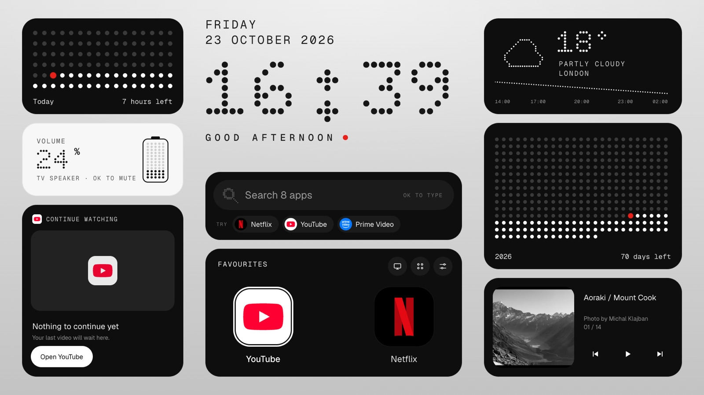
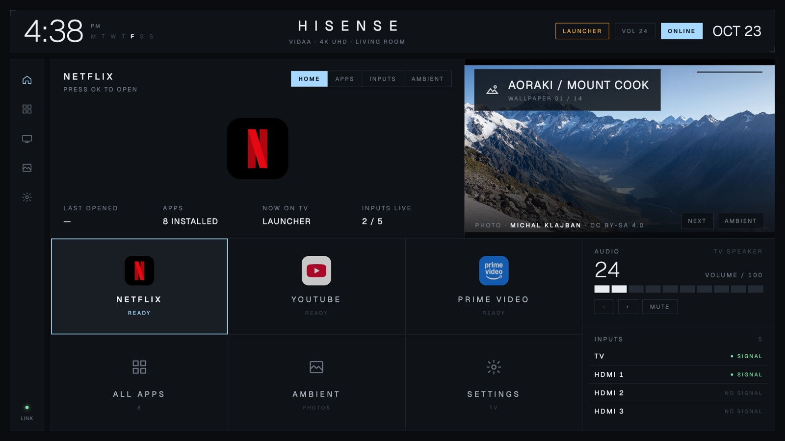
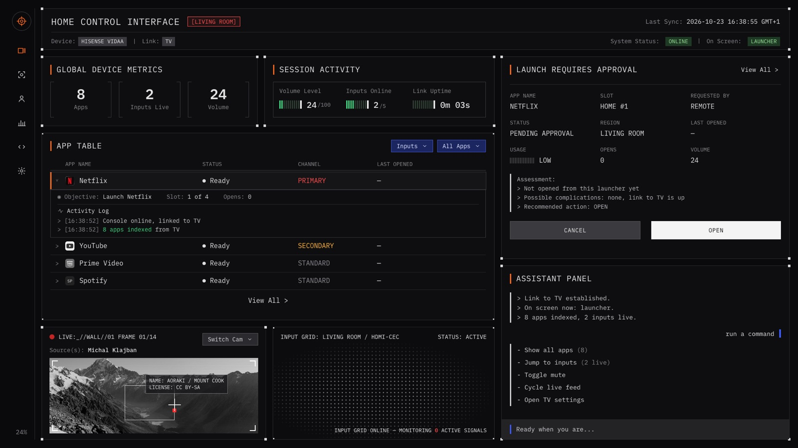
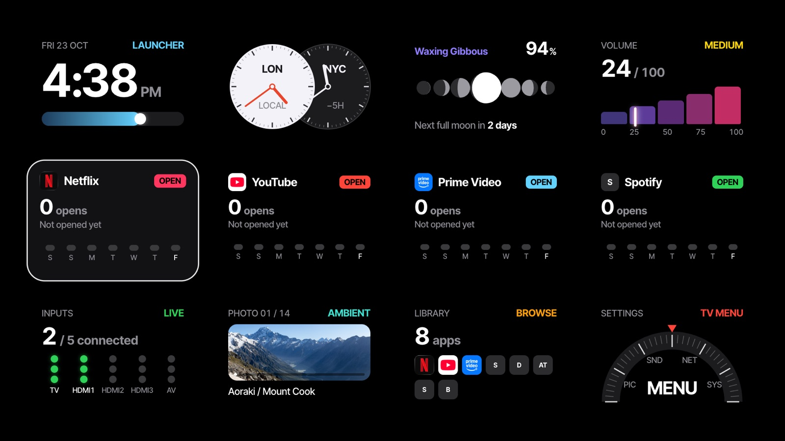
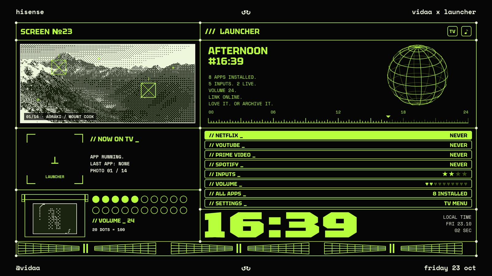
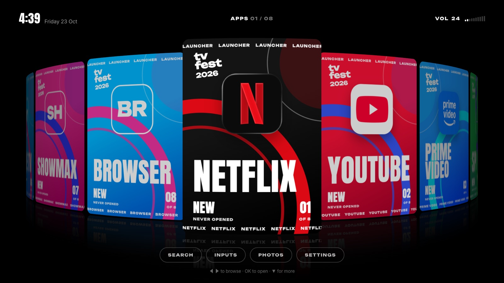
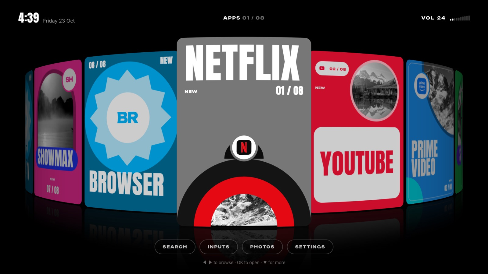
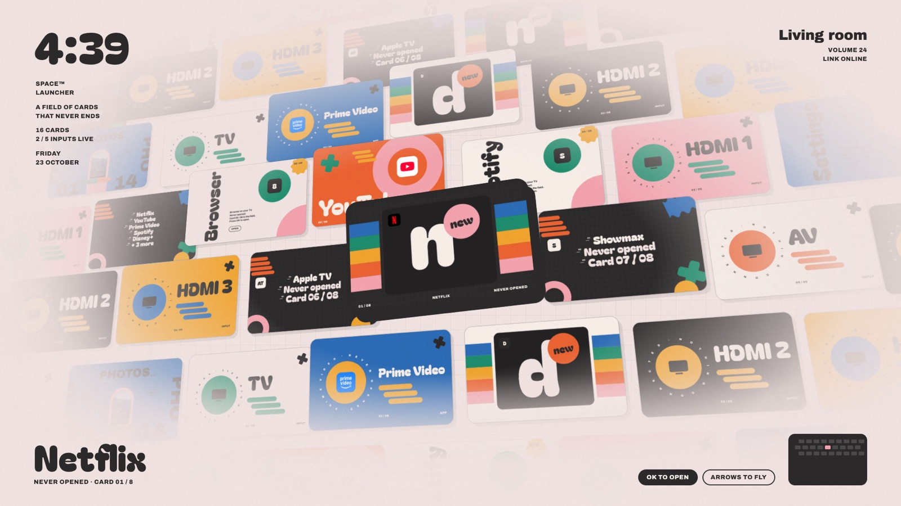
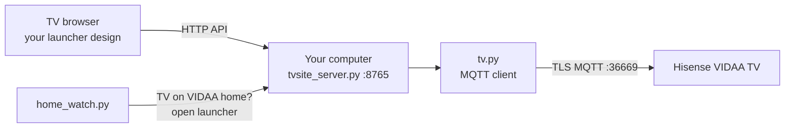

<h1 align="center">Channel 0</h1>

<p align="center">A custom home screen for Hisense VIDAA TVs. The channel before every other channel.</p>

<p align="center">
  
</p>

VIDAA doesn't let you install apps or change its home screen. Channel 0 works around that. A small Python server on your computer talks to the TV over its own remote-control channel, and every time the TV lands on VIDAA's home screen, it opens your launcher instead. The launcher is a web page running in the TV's built-in browser, so it can look like anything.

It ships with eight designs. Switch between them from the remote.

## Designs

| | |
|---|---|
| **1 · Dashboard**<br>Car-infotainment style. Apps, inputs, volume and wallpaper in one grid.<br> | **2 · Console**<br>Mission-control terminal with an app table, live metrics and an assistant panel.<br> |
| **3 · Widgets**<br>A wall of widgets: world clocks, moon phase, per-app usage, input signals.<br> | **4 · Acid**<br>Acid-green retro HUD with a wireframe globe and dithered photos.<br> |
| **5 · Carousel 1**<br>A curved WebGL ribbon of poster cards, with search by D-pad.<br> | **6 · Carousel 2**<br>The same ribbon with bolder, graphic posters.<br> |
| **7 · Space**<br>An endless WebGL field of retro-pop cards you fly through.<br> | **8 · Nothing**<br>Dot-matrix type, monochrome widgets, weather, Continue Watching.<br> |

**Switching designs:** press **Back twice** to open the picker, or press **1–8** on the remote. The server remembers your choice.

## Features

- **Takes over Home.** Press Home on the TV remote and your launcher opens instead of VIDAA's.
- **Real controls.** Open apps, switch HDMI inputs, change volume and mute, all from the launcher.
- **Live state.** Volume, the input with a signal, and what's on screen update as they change.
- **Continue Watching.** Remembers the last YouTube video playing on the TV and resumes it.
- **Voice search from your phone.** Scan a QR code, talk, and the words appear on the TV.
- **Weather, world clocks, moon phase,** and 14 rotating 4K wallpapers.
- **Fast on TV hardware.** Every design is tuned for the TV's browser (Chrome 111 on a Mali-G52 GPU).

## How it works



1. **Talking to the TV.** VIDAA TVs run an MQTT broker on port 36669 that the official phone remote uses. `tv.py` connects to it over TLS and sends the same commands: launch app, change source, set volume, get state.
2. **Pairing on newer firmware.** Recent VIDAA firmware rejects the fixed login older projects used. `tv.py` uses per-device dynamic credentials, then a token flow: the TV shows a 4-digit code, you confirm it, and the TV issues an access token (valid 2 days) and a refresh token (30 days). The server refreshes it automatically.
3. **Opening the launcher.** Instead of installing an app with `hisense://debug`, the server asks the TV to open the launcher's URL directly as an app, so it opens straight away and needs no install.
4. **The takeover.** `home_watch.py` checks the TV's state. When it sees VIDAA's home screen, it opens your launcher.
5. **The designs.** Plain HTML, CSS and JS, plus WebGL for the carousel and space designs. They call the server's API (`/api/apps`, `/api/sources`, `/api/volume`, `/api/launch` and others) and use the remote's D-pad for navigation.

**Firmware quirks we hit:**
- The TV refuses `#` wildcard subscriptions, so every topic is subscribed by exact name.
- Only one session per paired ID: a second connection kicks the first, so everything goes through the one server.
- The token request goes to `.../data/gettoken`, not `.../actions/`.
- The TV doesn't reliably broadcast changes made with its own remote, so volume and state are re-queried when they go stale.

## Setup

**You need:** a Hisense VIDAA TV, and a Mac or any always-on computer on the same Wi-Fi with Python 3.

### 1. Install

```sh
git clone https://github.com/kmcdotninja/channel-0.git
cd channel-0
python3 -m venv .venv
.venv/bin/pip install -r requirements.txt
```

### 2. Add the client certificate

The TV only accepts connections from a client with a known certificate. It isn't included in this repo. You need to supply your own and place it in `server/keys/`.

**Newer firmware:** follow [pyvidaa's "Obtaining the client certificate"](https://github.com/warrenrees/pyvidaa#obtaining-the-client-certificate), then convert it to PEM files:

```sh
mkdir -p server/keys
openssl pkcs12 -legacy -in <certificate>.p12 -clcerts -nokeys -out server/keys/vidaa_client.pem
openssl pkcs12 -legacy -in <certificate>.p12 -nocerts -nodes -out server/keys/vidaa_client.key
```

**Older firmware:** the RemoteNow files from [Hisense-mqtt-keyfiles](https://github.com/d3nd3/Hisense-mqtt-keyfiles) also work. Save them as `server/keys/rcm_certchain_pem.cer` and `server/keys/rcm_pem_privkey.pkcs8`.

Not sure which firmware you have? Try the newer certificate first. If pairing says "Not authorized", try the other.

### 3. Pair with your TV

Turn the TV on and find its IP address (Settings → Network). From the `server/` folder:

```sh
export HISENSE_HOST=<tv-ip>
../.venv/bin/python pair_daemon.py
```

A 4-digit code appears on the TV. In a second terminal, from the repo folder:

```sh
echo 1234 > server/.paircode    # the code on your TV
```

It prints `PAIRED`. The login is saved to `server/.auth.json`. It's private and ignored by git.

### 4. Run it

From `server/`, in two terminals:

```sh
HISENSE_HOST=<tv-ip> ../.venv/bin/python tvsite_server.py launcher 8765
HISENSE_HOST=<tv-ip> ../.venv/bin/python home_watch.py
```

Press **Home** on the TV remote. Your launcher opens.

To pause the takeover, create an empty file `server/.home_watch_off`. Delete it to resume. The computer has to stay awake.

### Optional settings

| Setting | How |
|---|---|
| Weather location | `WEATHER_CITY=Paris WEATHER_LAT=48.85 WEATHER_LON=2.35` when starting the server |
| Greeting name (Nothing design) | Open `d7-nothing.html?name=YourName` |
| Voice search from your phone | Run `mkdir -p server/keys/https && openssl req -x509 -newkey rsa:2048 -nodes -days 3650 -subj /CN=channel-0 -keyout server/keys/https/key.pem -out server/keys/https/cert.pem`, then restart the server. The voice page runs on port 8766. |
| Preview a design on your computer | `http://localhost:8765/<design>.html` |

## Repo layout

```
launcher/          the designs (HTML/JS), fonts, wallpapers, design picker (designs.js)
server/
  tvsite_server.py   web server + API the designs call
  tv.py              MQTT client: pairing, tokens, commands
  backend_rpc.py     one shared TV session behind the API
  home_watch.py      opens the launcher when the TV is on VIDAA home
  pair_daemon.py     one-time pairing
  yt_lounge.py       remembers the YouTube video for Continue Watching
  discover.py        finds the TV on the network
docs/screenshots/  the images above
```

## Credits

- Built on [Zfinix/vidaa-launcher](https://github.com/Zfinix/vidaa-launcher) (MIT), which started the MQTT bridge and the original canvas launcher (still at `/launcher-canvas.html`).
- Fonts are open source (SIL Open Font License) and bundled in `launcher/fonts/`.
- Wallpapers are CC BY-SA, credited in `launcher/bg/credits.json`. App logos belong to their owners.
- Not affiliated with Hisense or VIDAA.

## License

MIT
